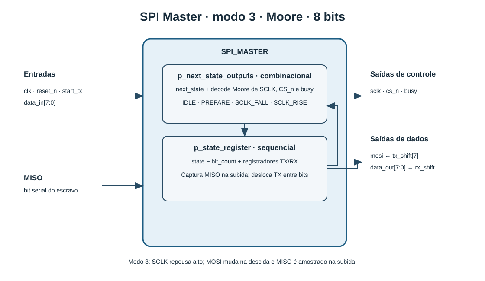
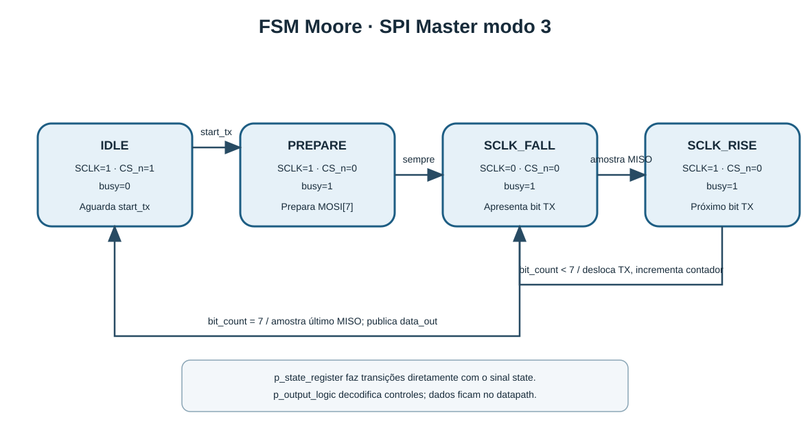

# SPI Master em VHDL

Projeto acadêmico de um mestre SPI full-duplex de 8 bits. O componente foi escrito em VHDL e organizado para estudo da interface, da máquina de estados Moore e da validação por testbench.

Autor: [Vinícius Oliveira](https://github.com/vinicoli).

| Protocolo | Palavra | FSM | Versão |
|---|---:|---|---:|
| SPI modo 3 (`CPOL=1`, `CPHA=1`) | 8 bits, MSB primeiro | Moore, 4 estados | `0.1.0` |

> O testbench está incluído; a execução funcional ainda precisa ser confirmada em um ambiente ModelSim compatível.

## O que o projeto demonstra

- Transmissão e recepção simultâneas de um byte.
- Geração de `SCLK` a partir do clock de referência, sem entrada de divisor: `SCLK = clk/2` durante a transferência.
- Controle do escravo por `cs_n` ativo baixo.
- FSM Moore com um único sinal de estado e dois processos: um sequencial para estado/datapath e um combinacional para decodificar as saídas de controle.
- Testbench com um escravo simulado para conferir a sequência serial e os casos de controle.

## Arquitetura

### Diagrama de bloco



### Interface

| Direção | Sinal | Descrição |
|---|---|---|
| Entrada | `clk` | Clock de referência do sistema. |
| Entrada | `reset_n` | Reset assíncrono ativo baixo. |
| Entrada | `start_tx` | Pulso de um ciclo para iniciar uma transferência; aceito somente quando `busy='0'`. |
| Entrada | `data_in[7:0]` | Byte a transmitir, MSB primeiro. |
| Entrada | `miso` | Bit serial recebido do escravo. |
| Saída | `sclk` | Clock SPI modo 3; repousa alto. |
| Saída | `mosi` | Bit serial enviado ao escravo. |
| Saída | `cs_n` | Chip Select ativo baixo. |
| Saída | `busy` | Indica que uma transferência está em andamento. |
| Saída | `data_out[7:0]` | Byte recebido; atualizado na conclusão da transferência. |

Não há sinal `done`: a conclusão é indicada por `busy` voltando a zero. `data_out` mantém o último byte concluído até a próxima transferência ou reset. Um `start_tx` recebido enquanto `busy='1'` é ignorado; não há fila de comandos.

### Temporização SPI

No modo 3, `SCLK` fica alto em repouso (`CPOL=1`) e os dados são amostrados na borda de subida (`CPHA=1`). O mestre apresenta/avança `MOSI` na borda de descida e amostra `MISO` na borda de subida. `cs_n` é ativado antes da primeira descida e desativado junto à subida final.

### Máquina de estados Moore



| Estado | `sclk` | `cs_n` | `busy` | Ação |
|---|---:|---:|---:|---|
| `IDLE` | 1 | 1 | 0 | Aguarda `start_tx` e captura `data_in`. |
| `PREPARE` | 1 | 0 | 1 | Ativa o escravo e prepara o primeiro bit. |
| `SCLK_FALL` | 0 | 0 | 1 | Apresenta o bit de transmissão; na transição para a fase alta, captura `miso`. |
| `SCLK_RISE` | 1 | 0 | 1 | Mantém a fase alta e prepara o próximo bit, quando houver. |

Os sinais de controle `sclk`, `cs_n` e `busy` são decodificados somente a partir do estado atual. `mosi` e `data_out` pertencem ao datapath e vêm dos registradores de deslocamento.

## Estrutura do repositório

```text
.
├── src/spi_master.vhd          # entidade e RTL do mestre SPI
├── tb/tb_spi_master.vhd        # testbench com escravo SPI simulado
├── sim/run.do                  # compilação e execução no ModelSim
├── docs/diagrama_bloco.svg     # interface e blocos internos
├── docs/diagrama_fsm.svg       # estados e transições
├── PLANO_PROJETO_SPI_MASTER.md # especificação detalhada do projeto
├── CONTRIBUTING.md             # Conventional Commits e SemVer
└── VERSION                     # versão atual: 0.1.0
```

## Simulação no ModelSim

O script compila RTL e testbench em VHDL-93, carrega a simulação, adiciona os sinais à janela de ondas e executa por 2 µs. A partir da raiz do projeto, no prompt do ModelSim:

```tcl
do sim/run.do
```

Ao terminar, a mensagem `All SPI master testbench checks passed` indica que as verificações passaram. Um `assertion failure` aponta a verificação que falhou.

O testbench cobre:

- reset em repouso e durante uma transferência;
- níveis de repouso do modo 3 e preparação de `cs_n`;
- alternância de `sclk` em relação a `clk`;
- bytes de transmissão/recepção `A5`/`3C` e `96`/`C3`, MSB primeiro;
- retenção de `data_out` durante a transferência;
- `start_tx` ignorado enquanto ocupado.

## Uso no Quartus II

Crie um projeto Quartus, adicione `src/spi_master.vhd` como arquivo VHDL e defina `spi_master` como entidade de topo. A seleção do dispositivo FPGA e as atribuições de pinos dependem da placa utilizada e não estão incluídas neste projeto.

## Versionamento

O projeto usa SemVer e Conventional Commits. A versão corrente é `0.1.0`; regras e exemplos estão em [CONTRIBUTING.md](CONTRIBUTING.md). O histórico do projeto e a tag inicial [`v0.1.0`](https://github.com/vinicoli/spi-master/tree/v0.1.0) estão no GitHub.
